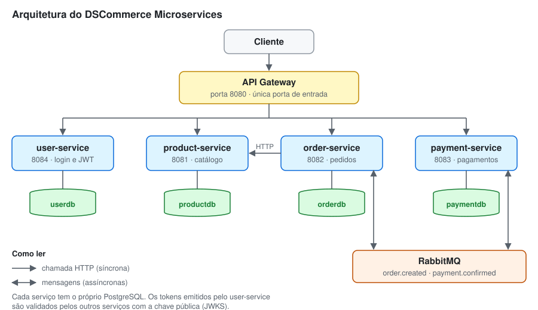
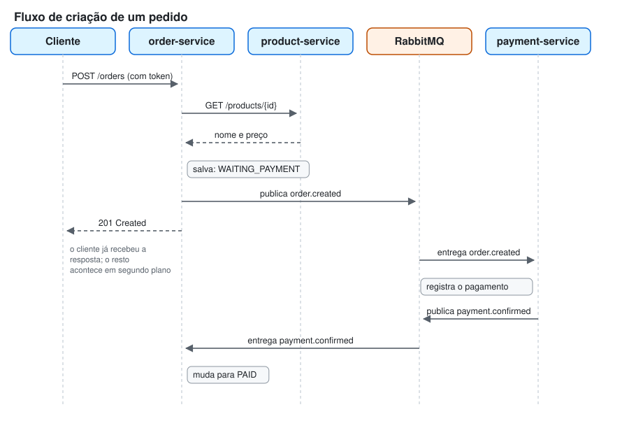

# DSCommerce Microservices


Versão evoluída do meu projeto [DSCommerce](https://github.com/638594/DSCommerce): a mesma API REST de e-commerce, **reescrita do zero como microsserviços** com Java 21 e Spring Boot 4.

## Sumário

- [Sobre o projeto](#sobre-o-projeto)
- [Arquitetura](#arquitetura)
- [Decisões de arquitetura](#decisões-de-arquitetura)
- [Fluxo de um pedido](#fluxo-de-um-pedido)
- [Tecnologias](#tecnologias)
- [Como rodar](#como-rodar)
- [Endpoints](#endpoints)
- [Roadmap](#roadmap)
- [Limitações conhecidas](#limitações-conhecidas)

## Sobre o projeto

O DSCommerce original é um monolito: uma única aplicação, um único banco de dados. Ele funciona bem, mas não exercita os problemas que os sistemas de hoje precisam resolver: serviços que sobem e caem de forma independente, comunicação entre partes do sistema pela rede, autenticação compartilhada entre várias aplicações e dados espalhados em vários bancos.

Este projeto foi um **desafio pessoal de aprendizado**: reconstruir o mesmo domínio (produtos, pedidos, pagamentos e usuários) aplicando o que se espera de um projeto de software moderno, e entender na prática **por que** cada decisão existe, e não só como usá-la. Cada etapa foi construída e testada de forma incremental, provocando falhas de propósito (desligar um serviço, derrubar o broker, reiniciar um banco) para ver como o sistema reage.

| | Monolito (DSCommerce) | Microsserviços (este projeto) |
|---|---|---|
| Estrutura | Uma aplicação | 5 aplicações independentes |
| Banco de dados | Um banco compartilhado | Um PostgreSQL por serviço |
| Comunicação interna | Chamada de método | HTTP e mensageria (RabbitMQ) |
| Autenticação | JWT com chave simétrica (HS256) | JWT com par de chaves (RS256) e JWKS |
| Entrada da API | A própria aplicação | API Gateway |
| Esquema do banco | Gerado pelo Hibernate | Versionado com Flyway |
| Falha em pagamentos | Pode afetar a aplicação inteira | Pedidos continuam sendo aceitos; o pagamento é processado quando o serviço volta |

## Arquitetura



Cada serviço tem o **seu próprio banco PostgreSQL** e não acessa as tabelas dos outros.

| Serviço | Porta | Responsabilidade |
|---|---|---|
| gateway | 8080 | Porta única de entrada: roteia cada requisição para o serviço certo e centraliza o CORS |
| user-service | 8084 | Login, emissão do JWT (RS256) e publicação da chave pública (JWKS) |
| product-service | 8081 | Catálogo de produtos e categorias |
| order-service | 8082 | Criação e consulta de pedidos |
| payment-service | 8083 | Processamento de pagamentos a partir de eventos |

## Decisões de arquitetura

- **HTTP só quando a resposta é necessária na hora.** O order-service busca nome e preço no product-service por HTTP, com timeout de conexão e de leitura. Se o catálogo estiver fora do ar, o pedido falha com `503` em vez de travar.
- **Mensageria para avisos.** "Pedido criado" e "pagamento confirmado" viajam como eventos pelo RabbitMQ (topic exchange, uma fila por consumidor). Se o payment-service estiver fora do ar, a mensagem espera na fila e é processada quando ele voltar.
- **Um banco por serviço.** Nenhuma entidade atravessa a fronteira de um serviço: o pedido guarda `clientId` e `productId`, nunca o objeto.
- **Snapshot de preço.** O item do pedido guarda nome e preço do produto no momento da compra. Uma mudança de preço no catálogo não altera pedidos antigos.
- **JWT assinado com par de chaves (RS256).** Só o user-service tem a chave privada. Os outros serviços conferem a assinatura e o emissor com a chave pública, sem consultar o banco de usuários e sem conseguir emitir tokens.
- **Defesa em profundidade.** O gateway apenas roteia; cada serviço valida o token, e continua protegido mesmo se for chamado sem passar pelo gateway.
- **Consumidor idempotente.** O payment-service ignora mensagens repetidas (`orderId` único), porque o RabbitMQ garante entrega "pelo menos uma vez".
- **Esquema versionado com Flyway.** As tabelas são criadas por scripts SQL versionados em cada serviço, e o Hibernate apenas valida o mapeamento (`ddl-auto=validate`).
- **Erros em formato único.** Todos os erros da API, inclusive os `401` e `403` do Spring Security, seguem o mesmo JSON.
- **Configuração por variável de ambiente.** Credenciais e endereços têm valores padrão apenas para desenvolvimento local.

## Fluxo de um pedido



O cliente recebe a resposta assim que o pedido é salvo. O pagamento acontece depois, em segundo plano, e o pedido muda de status sozinho.

## Tecnologias

| Categoria | Tecnologias |
|---|---|
| Linguagem e framework | Java 21, Spring Boot 4, Spring Data JPA, Bean Validation |
| Segurança | Spring Security, OAuth2 Resource Server, JWT RS256, JWKS |
| Comunicação | RestClient (HTTP), Spring AMQP com RabbitMQ |
| Gateway | Spring Cloud Gateway (Web MVC) |
| Dados | PostgreSQL 17, Flyway |
| Infraestrutura | Docker Compose, Maven |

## Como rodar

**Pré-requisitos:** Java 21 e Docker.

```bash
# 1. Clonar o repositório
git clone https://github.com/638594/dscommerce-microservices.git
cd dscommerce-microservices

# 2. Subir o RabbitMQ e os 4 bancos PostgreSQL
docker compose up -d

# 3. Subir cada serviço (um terminal por serviço, ou pela IDE)
cd user-service    && ./mvnw spring-boot:run
cd product-service && ./mvnw spring-boot:run
cd order-service   && ./mvnw spring-boot:run
cd payment-service && ./mvnw spring-boot:run
cd gateway         && ./mvnw spring-boot:run
```

Na primeira inicialização, o Flyway cria as tabelas e os dados de exemplo de cada banco. Os dados ficam salvos em volumes do Docker; para começar do zero, use `docker compose down -v`.

Painel do RabbitMQ: http://localhost:15672 (usuário `dscommerce`, senha `dscommerce`).

### Testando com o Postman

Importe o arquivo `DSCommerce-Microservices.postman_collection.json`. As requisições de login salvam o token automaticamente na variável `{{token}}`, usada pelas demais requisições.

| Usuário | Senha | Papéis |
|---|---|---|
| maria@gmail.com | 123456 | CLIENT |
| alex@gmail.com | 123456 | CLIENT, ADMIN |

## Endpoints

Todos acessados pelo gateway, em `http://localhost:8080`.

| Método | Rota | Acesso | Descrição |
|---|---|---|---|
| POST | `/auth/login` | Público | Login; devolve o token |
| GET | `/users/me` | Autenticado | Dados do usuário logado |
| GET | `/products` | Público | Lista paginada, com filtro por nome |
| GET | `/products/{id}` | Público | Detalhes de um produto |
| POST | `/products` | ADMIN | Cria um produto |
| PUT | `/products/{id}` | ADMIN | Atualiza um produto |
| DELETE | `/products/{id}` | ADMIN | Remove um produto |
| POST | `/orders` | Autenticado | Cria um pedido |
| GET | `/orders` | Autenticado | Pedidos do usuário logado, paginados |
| GET | `/orders/{id}` | Dono do pedido ou ADMIN | Detalhes de um pedido |
| GET | `/payments` | ADMIN | Lista os pagamentos |

Formato de todos os erros:

```json
{
  "timestamp": "2026-11-18T12:00:00Z",
  "status": 403,
  "error": "Acesso negado",
  "path": "/products",
  "errors": []
}
```

## Roadmap

- [x] product-service com banco próprio
- [x] order-service com comunicação HTTP, timeout e tratamento de falhas
- [x] payment-service com mensageria (RabbitMQ) e consumidor idempotente
- [x] user-service com JWT RS256 e endpoint JWKS
- [x] Autorização nos serviços (ADMIN, dono do pedido, validação do emissor)
- [x] API Gateway como porta única de entrada
- [x] Erros padronizados, inclusive os de segurança, e listagem dos pedidos do cliente
- [x] PostgreSQL por serviço e esquemas versionados com Flyway
- [ ] Serviços em containers: Dockerfile por serviço, tudo com um `docker compose up` e só o gateway exposto
- [ ] Revisão de código: acesso a pedidos de terceiros como `404`, `sub` do token como id, limites no pedido
- [ ] Testes automatizados (unitários e com Testcontainers) e CI no GitHub Actions
- [ ] Resiliência: pagamento recusado com cancelamento do pedido (saga), Transactional Outbox, Dead Letter Queue e circuit breaker
- [ ] email-service consumindo os eventos existentes
- [ ] Observabilidade: health checks, tracing distribuído e logs correlacionados
- [ ] Deploy na nuvem

## Limitações conhecidas

- Os serviços ainda rodam fora do Docker, e as portas de todos ficam acessíveis na máquina local.
- A chave RSA é gerada na inicialização do user-service; reiniciá-lo invalida os tokens já emitidos.
- O evento é publicado dentro da transação do pedido, sem Outbox: uma falha entre a publicação e o commit pode gerar inconsistência.
- O pagamento é simulado e sempre aprovado.

## Autor

**Luiz Roberto** · [GitHub](https://github.com/638594)
